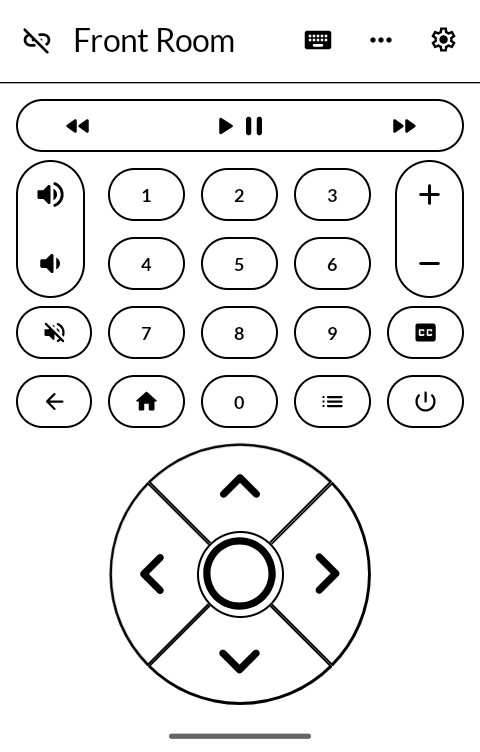
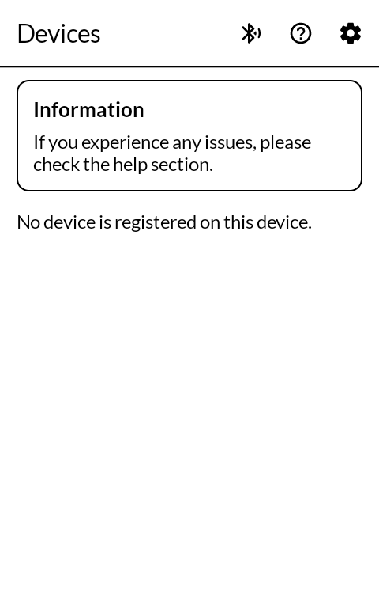
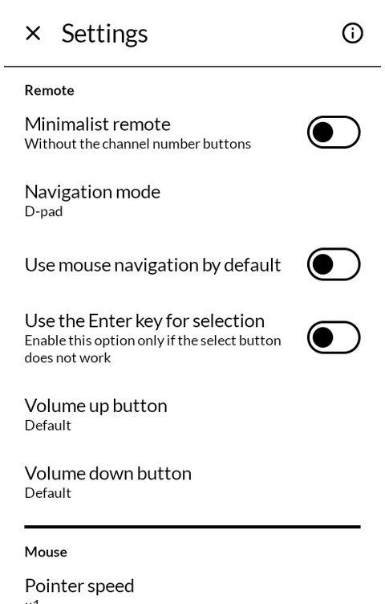
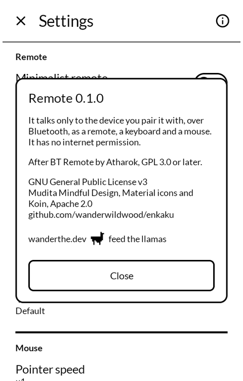

# 遠隔 enkaku — Remote

A Bluetooth remote, keyboard and mouse for an E Ink phone, and a Wi-Fi remote for Kodi. Black on white, Lato, nothing that slides.

*Enkaku* means at a distance: the plain word for "remote".

Built for the [Mudita Kompakt](https://mudita.com/products/kompakt/), whose 4.3" panel has
sixteen greys and a slow redraw.

## Screenshots

| | | | |
|---|---|---|---|
|  |  |  |  |

## What it is

Atharok's [BT Remote](https://gitlab.com/Atharok/BtRemote), dressed for E Ink. Everything
that makes it a good remote is his and unchanged: the phone pairs with a television, a
media box or a computer as an ordinary Bluetooth remote, keyboard and mouse, so nothing has
to be installed on the other end. A d-pad or a touchpad, media and channel buttons, a mouse
pad, two keyboards, and the volume keys put to work.

What is mine is how it looks on this screen, and one addition:

**Kodi over Wi-Fi.** The same remote can drive Kodi (LibreELEC, OSMC, any Kodi) over the
home network instead of Bluetooth, through Kodi's JSON-RPC, which spares the phone's
Bluetooth. Kodi boxes that announce themselves are listed; any other is an address away. The
last one used is a single press on the list of devices. Turn on Settings › Services › Control
› Allow remote control via HTTP in Kodi. The buttons, the d-pad and the text keyboard work;
the mouse and brightness have no Kodi equivalent and are left out.

## What changed for E Ink

**One appearance.** The light, dark, black and wallpaper themes are gone. The panel can
only show dark marks on a light ground, and a theme setting it cannot honour is a setting
that lies.

**Black edges instead of shadows.** Every button is white inside a black rim. A shadow on
this panel is a band of dithered grey.

**Mudita's type and components.** Lato at [MMD](https://github.com/mudita/MMD)'s sizes; top
bars, switches, lists, menus, text fields and buttons drawn the way MMD draws them; settings
rows without icons.

**Nothing moves.** No slides between screens, no fades, no spinners, no dimming behind a
dialog. The keyboards open as a plain panel along the bottom.

**Fewer presses.** The remote's ⋮ menu is gone: disconnect sits where back would, and mouse,
keyboard, more buttons and settings are each one press. Speeds are a short list rather than
a slider, which would repaint the panel at every step.

## Getting it, and keeping it

Download <https://github.com/wanderwildwood/enkaku/releases/latest/download/enkaku.apk> and
sideload it. That address always points at the newest release, and every release publishes a
`.sha256` beside the APK.

For updates, add this repository to [Obtainium](https://github.com/ImranR98/Obtainium):

    https://github.com/wanderwildwood/enkaku

It installs beside BT Remote rather than over it.

## Building

```
./gradlew assembleRelease
```

A release is signed by a keystore in `signing/`, which is not in this repository. Without it
the release APK builds **unsigned** and will not install anywhere — there is no fallback key
by design.

## Privacy

See [PRIVACY.md](PRIVACY.md). In short: it talks only to the device you pair it with, over
Bluetooth, or to the Kodi you choose on your home Wi-Fi, and to nothing else.

## Licence

**GNU General Public License v3.0 or later.** See [LICENSE](LICENSE).

This is *or later*, not the GPL-3.0-only these apps otherwise use. BT Remote is published
under "version 3 of the License, or (at your option) any later version", and that option
was granted to everyone downstream. It is not mine to take away.

Mudita Mindful Design is © Mudita, Apache 2.0. Lato is © Łukasz Dziedzic, SIL Open Font
License 1.1.

Copyright © wander wildwood, and © Atharok for the parts that are theirs.
